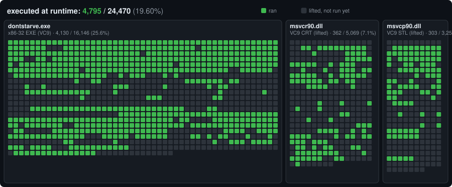
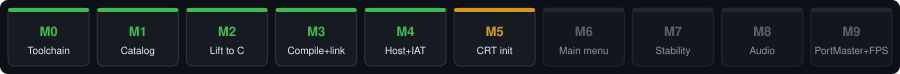
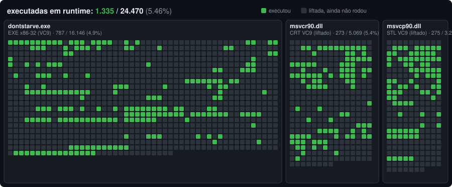
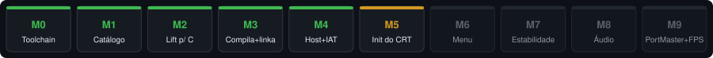

# Don't Starve — Native ARM64 Recompilation for R36S

**[English](#english) · [Português](#português)** · 📊 **[Live status dashboard](https://fernandoalves25.github.io/dontstarve-recomp/)**


> ⚠️ **No game files are included.** This repo holds only original tooling and runtime.
> You need your own legally obtained copy of Don't Starve. / **Nenhum arquivo do jogo é incluído.**

---

## English

Static recompilation of **Don't Starve** (PC, single-player) into **native ARM64 C** for the
R36S handheld (Rockchip RK3326, 4× Cortex-A35, ArkOS / PortMaster) — **no box64, no runtime
emulation**. Built on [pcrecomp](https://github.com/sp00nznet/pcrecomp), following the approach
proven by [nfsu2-recompiled-r36s](https://github.com/manuelpllull/nfsu2-recompiled-r36s).

**Why:** the current box64 port tops out around **20–22 FPS**, CPU-bound on x86→ARM translation
overhead over the Lua VM. Native code removes that overhead — while keeping everything the
Android port loses: all DLCs (RoG, Shipwrecked, Hamlet), **mods**, the **PT-BR translation**
and the PC UI.

### How it works

1. The Windows **DRM-free standalone** `dontstarve.exe` (x86-32 PE, VC9) is disassembled and lifted to C99.
   *(pcrecomp has no ELF front-end — its "64-bit path" is Win64 PE — so the Linux build is not usable.)*
2. The **VC9 C/C++ runtime** (`msvcr90.dll`, `msvcp90.dll`) is **lifted too**, so the STL and
   CRT run as guest code with their exact ABI — no hand-written `std::string` shims.
3. A custom **64-bit arena host** runs it all: the guest lives in a contiguous arena, guest
   pointers stay 32-bit, every access is `arena_base + va`. The same model ships on aarch64.
4. Only the real OS boundary is HLE (kernel32 / user32 / gdi32 …). Graphics are already GLES2
   (ANGLE), so they bridge straight to the Mali GPU — no D3D9 translation layer needed.

### Status

**How much of the game actually runs.** Every function is already *lifted* to C — that's the
easy part. What matters is how many have **executed** natively without crashing. Each cell ≈ 16
functions: **bright = ran at runtime**, dim = lifted but never reached yet. Today execution runs
through the CRT startup and the game's own init, runs the game's Lua scripts, **draws the main menu**, generates
a new world and **plays in it** (the character, HUD and creatures), at 640×480. The map
fills in as the port progresses (measured with a `COVERAGE=1` build, see `scripts/coverage_counts.py`).





| Milestone | Status |
|---|---|
| M0 Input decision + toolchain | ✅ done |
| M1 Function catalog — 16,146 functions (standalone exe) | ✅ done |
| M2 Lift to C99 — 4.2M lines, **0 failures** | ✅ done |
| M3 Compiles + links (exe + 2 lifted CRT DLLs) | ✅ done |
| M4 Arena host, IAT binding (955/955), CRT `DllMain` runs | ✅ done |
| M5 CRT initialization — both CRT `DllMain`s + exe CRT startup, game `main()` runs | ✅ done |
| M6 Native main menu — the recompiled game draws its menu (headless x86-64 + Mesa) | ✅ done |
| **M7 Stability** | 🟡 **in progress — a new world generates and loads; Wilson walks, picks up items; 6,000-frame sessions exit cleanly** |
| **M8 Audio (FMOD Ex shim)** | 🟡 **in progress — real sound: the game's `.fev` events → FSB5 Vorbis waves → SDL mixer, 3D pan/attenuation** |
| **M9 PortMaster package + FPS vs box64** | 🟡 **aarch64 build (glibc 2.17) runs under qemu with sound; package from [scripts/make_port.sh](scripts/make_port.sh); needs a real R36S** |

### 🙋 Where help is needed

**Playing, with sound (M7 + M8).** A scripted headless run goes Play → New Game → Start, holds a
direction key and **Wilson walks** across the map (grass, then the coast, "Pick Sapling" under the
cursor) — **5,212 functions executed (4,521 in the game exe)**, exit code 0 after 6,000 frames.
**Saving and loading work**: the save the game writes after world generation shows up as
"Survival 1-1" and Continue loads it back into the same world. An 11,000-frame session ran through
nightfall, Wilson's death in the dark and the "You are dead!" screen without a host error.
The FMOD shim now **makes sound** ([ds_audio.c](src/runtime/ds_audio.c), `DS_AUDIO=sdl`): it reads
the game's own `.fev` project files (2,300+ events → sound definitions → waves), plays the waves out
of the 50 FSB5 banks (7,571 Vorbis streams) through an SDL mixer with 32 voices and 3D
pan/attenuation from the listener. Events follow their FEV data: each layer has its own voice and
plays while its parameter is in range (the `daytime` ambience switches day/night layers), loop
modes, per-definition volume and spawn intervals (ocean waves, random bird and wind ambience), and
the category volumes the game's mixer sets (`set_music/soundtrack`, `set_sfx/voice`, pause and
death mixes). Decoded audio stays under a memory budget (`DS_AUDIO_MB`, default 192, 96 on aarch64). FSB5 strips the Vorbis setup headers; the host rebuilds them with
libvorbis's own encoder and checks each against the bank's CRC32 (cached in
`$DS_HOME_DIR/vorbis_setups.bin`). The low-rate (8–24 kHz) setups came out of another encoder
build; [tools/audio/import_setups.py](tools/audio/import_setups.py) takes them from
[python-fsb5](https://github.com/HearthSim/python-fsb5)'s table (MIT) — then **all 7,571 waves
decode** (`DS_AUDIO_CHECK=1` decodes each once and reports). Menu music, footsteps, rabbits, birds, HUD clicks all play. The
aarch64 build links the audio too (libvorbis/libogg/zlib static, still glibc 2.17) and plays the menu
music under qemu.

**Milestones M6 + into a world.** Scripted clicks (`DS_INPUT`) take a headless run through
Play → New Game → Start: the `WorldSim` thread generates the world (voronoi map, tile map, roads,
"Generation complete"), the game loads it and simulates it with the player, the HUD and the
creatures — **4,795 functions executed**. The **SDL2 backend** (`DS_VIDEO=sdl`) draws the same
frames in an SDL window with an SDL game controller as XInput pad 0. The whole tree
**cross-compiles for aarch64** at `-O2` ([scripts/build_arm64.sh](scripts/build_arm64.sh)) against
an Ubuntu 18.04 sysroot, so the binary needs only **glibc 2.17** (ArkOS has 2.30); under
`qemu-aarch64` it boots and draws the same main menu. A PortMaster launcher is in
[port/dontstarve.sh](port/dontstarve.sh).

**Milestone M6: the main menu runs natively.** The recompiled `dontstarve.exe` (the DRM-free
standalone build; 16,146 functions, 0 lift failures) boots through the CRT, creates its window,
brings up EGL + GLES2, initializes (silent) FMOD, runs its Lua scripts (`main.lua`, player profile,
mod index, prefabs, shaders) and sits in its main loop **drawing the main menu** at 640×480 — about
50 fps on the Mesa llvmpipe *software* renderer of a headless x86-64 container. **3,370 functions
executed (2,745 in the game exe)**. Next: input into the menu, then a world (M7), the aarch64 build
for the R36S (M9), and real audio (M8).

What's in the runtime now ([src/runtime](src/runtime)):

- **EGL/GLES2 bridge** ([ds_gles.c](src/runtime/ds_gles.c)): the 9 EGL + 76 GLES2 ANGLE imports
  (by ordinal, mapped from the game's own `libEGL.dll`/`libGLESv2.dll`) onto native EGL/GLES2.
  `#extension` lines are hoisted to the top of each shader (ANGLE accepted them mid-file). Headless:
  a pbuffer on `EGL_PLATFORM_SURFACELESS_MESA`. `DS_DUMP_FRAMES=N` saves frames,
  `DS_EXIT_AFTER_FRAMES=N` exits cleanly, `DS_SCREEN=WxH` changes the 640×480 screen.
- **FMOD Ex + Event** ([ds_fmod.c](src/runtime/ds_fmod.c) + [ds_audio.c](src/runtime/ds_audio.c)):
  every object exists, every call succeeds; events play through the SDL mixer with `DS_AUDIO=sdl`. The virtual `EventProject`/`EventCategory`/`EventGroup` vtables come from the game's own
  `fmod_event.dll` (slot order and stack size per method).
- **USER32 + GDI32** ([ds_user32.c](src/runtime/ds_user32.c)): a headless window, one display mode
  and monitor. On first run the host writes a `settings.ini` for full screen at the panel size.
- **File I/O** ([ds_file.c](src/runtime/ds_file.c)): `Z:\dontstarve\…` → `$DS_GAME_DIR` (default
  `gamedata/`: your install's `bin/`, `data/`, `mods/`), `Z:\home\…` → `$DS_HOME_DIR` (default
  `build/home/`). Case-insensitive, as on Windows. `DS_FILE_TRACE=1` logs every open.
- **Bigger HUD for small screens** ([port/mods/r36s-hud](port/mods/r36s-hud)): a tiny mod that
  scales the in-game HUD, map and hover/speech text 1.4× (configurable 1.0–1.5×) through the game's
  own `GetHUDScale`; the PortMaster launcher enables it.
- **DXT without S3TC:** the game's textures are DXT5/DXT1; on a GPU without S3TC (the R36S's
  Mali-G31) the bridge decodes them on the CPU and uploads RGBA4444 (`DS_SOFT_DXT=rgba8` for full
  precision, `DS_SOFT_DXT=1` forces it; checked against the GPU path: max error 21/255). On aarch64
  textures are also kept one mip level smaller (`DS_TEX_HALF`, a quarter of the memory; at 640×480
  the frames come out the same).
- **SDL2** ([ds_sdl.c](src/runtime/ds_sdl.c), `DS_VIDEO=sdl`): window + GLES2 context, events into
  the message queue, the SDL game controller as XInput pad 0. **Input** ([ds_input.c](src/runtime/ds_input.c)).
  `DS_INPUT="F click X Y; F key VK"` scripts a headless run; `DS_PAD="F buttons HEX N; F stick LX LY N"`
  scripts a pad: the game shows "Controller Detected", the d-pad moves focus, A enables the
  controller and the menus switch to pad prompts.
- **Threads** ([ds_thread.c](src/runtime/ds_thread.c)): real threads under one machine lock, with
  preemption points (loop back-edges, every frame) so the world generator runs beside the renderer.
- **Guest heap** (kernel32): size-class free lists, so loading and unloading worlds recycles memory;
  freed blocks give their pages back to the OS (resident guest memory in a world: 605 → 285 MB),
  `DS_HEAP_STATS=N` reports live/free/quarantined bytes every N frames.
- **Offline Winsock** ([ds_net.c](src/runtime/ds_net.c)).
- **Lifter / runtime patches** ([patches/pcrecomp](patches/pcrecomp)): 0016 adds the x87
  `fcomi`/`fucomi[p]` compares (3,835 sites); 0017 gives the guest **real `setjmp`/`longjmp`**
  (`RECOMP_HOST_SETJMP`), so Lua's `pcall`/`error` unwinds the host C frames. pcrecomp's `difftest`
  matches hardware on 263/263 cases.
- **Debugging:** `DS_WATCH=va,…` prints a lifted function's arguments on entry (how a Lua error
  without a message got its message back); `DS_SENTINEL=1` catches return-address leaks.

Help wanted, in order:

- **On a real R36S:** the SDL2 backend over KMSDRM on the Mali GPU (written, tested with SDL's
  offscreen driver), the aarch64 build in a glibc ≤ 2.30 image for ArkOS, and FPS against box64.
- **Regenerating the low-rate Vorbis setups ourselves:** 6 of the 20 setup headers (8–24 kHz) match
  no libvorbis 1.3.x VBR setting tried (every rate 4–52 kHz × quality −0.1…1.0); for now they
  come from python-fsb5's table.
- **FMOD envelopes:** layers and parameters work, but the envelope curves (volume/pitch against a
  parameter) are not decoded yet; a full-range enveloped layer just fades with its parameter
  (music `intensity`).
- **Long play sessions:** days, nights, seasons, saving and loading.

Runtime fixes on the way (useful for anyone using pcrecomp): import-stub names were dangling
pointers (`GetProcAddress` stack buffers and ordinal names like `OLEAUT32.dll#9`), so a missing
import reported an empty or wrong name. `HeapSize` returned 0, so the CRT's `_msize`-sized onexit
table walked into string data at exit. Heap blocks now carry a size header.

How the CRT wall fell (for anyone hitting similar walls with pcrecomp): kernel32
`DecodePointer` shared a cdecl shim and didn't pop its argument, shifting `pop esi/pop ebp` in
the CRT's `_decode_pointer` — the `0xDEAD0000` `this`. Found by recompiling one lifted file with
`-g` and printing the lifted locals (`l_esp`, `l_esi`…) after every call under gdb. Then lifter
support for `lock xadd` and `rep ret` ([patches/pcrecomp](patches/pcrecomp)), then
relocation-based seeds ([scripts/reloc_seeds.py](scripts/reloc_seeds.py)) for CRT init tables
that recursive descent never reaches. `DS_SENTINEL=1` (COVERAGE build) aborts on the first
function entered with the sentinel in `esp`/`ebp`.

Ideas, PRs and discussion very welcome — see [docs/01-ARCHITECTURE.md](docs/01-ARCHITECTURE.md).

### Reproducing (you need your own game copy)

Requirements: Linux (or Windows + WSL) with gcc, EGL + GLES2 dev libraries (Mesa: `libegl-dev libgles-dev`),
Python 3.10+ with `capstone pefile unicorn keystone-engine`.

```bash
# 1. pcrecomp, pinned + patched (patches from nfsu2-recompiled-r36s)
git clone https://github.com/sp00nznet/pcrecomp && cd pcrecomp
git checkout 35548b8 && git am ../nfsu2-recompiled-r36s/patches/pcrecomp/*.patch
git am ../patches/pcrecomp/*.patch && cd ..   # this repo's own lifter fixes (0015+)

# 2. Put YOUR DRM-free dontstarve.exe (the standalone build, from bin/) in work/, plus
#    msvcr90.dll + msvcp90.dll (x86, 9.0.30729.x, from Windows WinSxS or a vcredist).
#    The Steam build (dontstarve_steam.exe) needs a running Steam client and won't start.

# 3. Lift — see scripts/
python pcrecomp/tools/cpp/vtable_scan.py work/dontstarve.exe --seeds work/vtable_seeds.json
python pcrecomp/tools/cpp/rtti.py        work/dontstarve.exe --seeds work/rtti_seeds.json
#    merge both into work/seeds_all.json (a JSON list, dedup by "address")
python scripts/run_lift.py catalog work/dontstarve.exe work/seeds_all.json work/catalog.json
python scripts/run_lift.py lift    work/dontstarve.exe work/catalog.json src/recomp/gen
bash   scripts/lift_dll.sh work/msvcr90.dll msvcr90_
bash   scripts/lift_dll.sh work/msvcp90.dll msvcp90_
python scripts/find_data_funcs.py work/msvcr90.dll work/msvcr90_catalog.json config/exclude.txt
python scripts/find_data_funcs.py work/msvcp90.dll work/msvcp90_catalog.json config/exclude.txt
#    then re-run the two DLL lifts so the exclude list applies (lift_dll.sh also adds reloc seeds)

# 4. Build + run the host (game data: DS_GAME_DIR=<your install dir>, default gamedata/)
bash scripts/build_guest_obj.sh && bash scripts/build_arena_host.sh
./build/dontstarve_host --run-entry
#    headless + scripted: DS_INPUT="1000 click 540 205" DS_DUMP_FRAMES=100 DS_EXIT_AFTER_FRAMES=1500
#    real window/pad:     DS_VIDEO=sdl ./build/dontstarve_host --run-entry

# 5. R36S (aarch64, glibc 2.17): sysroot, cross-build, then the PortMaster folder
python3 scripts/make_sysroot_bionic.py
SYSROOT=$PWD/build/sysroot-arm64 bash scripts/build_arm64.sh link     # build/dontstarve_host.aarch64
#    ports/dontstarve/: the binary, port/dontstarve.sh, gamedata/{bin,data,mods}, crt/msvc[rp]90.dll
```

---

## Português

Recompilação estática do **Don't Starve** (PC, single-player) para **C nativo ARM64** no
portátil R36S (Rockchip RK3326, 4× Cortex-A35, ArkOS / PortMaster) — **sem box64, sem emulação
em runtime**. Baseado no [pcrecomp](https://github.com/sp00nznet/pcrecomp), seguindo o caminho
provado pelo [nfsu2-recompiled-r36s](https://github.com/manuelpllull/nfsu2-recompiled-r36s).

**Por quê:** o port atual via box64 trava em torno de **20–22 FPS**, limitado pela CPU no
overhead da tradução x86→ARM sobre a VM Lua. Código nativo elimina esse overhead — mantendo
tudo que o port Android perde: todas as DLCs (RoG, Shipwrecked, Hamlet), **mods**, a
**tradução PT-BR** e a UI de PC.

### Como funciona

1. O `dontstarve.exe` **standalone DRM-free** de Windows (x86-32 PE, VC9) é desmontado e liftado para C99.
   *(o pcrecomp não tem front-end ELF — o "caminho 64-bit" dele é Win64 PE — então a build Linux não serve.)*
2. O **runtime C/C++ do VC9** (`msvcr90.dll`, `msvcp90.dll`) **também é liftado**, então a STL e
   o CRT rodam como código guest com o ABI exato — sem shims de `std::string` escritos à mão.
3. Um **host arena 64-bit** próprio roda tudo: o guest vive numa arena contígua, ponteiros do
   guest continuam 32-bit, todo acesso é `arena_base + va`. O mesmo modelo vai pro aarch64.
4. Só a fronteira real de SO é HLE (kernel32 / user32 / gdi32 …). Os gráficos já são GLES2
   (ANGLE), então ligam direto na GPU Mali — sem camada de tradução D3D9.

### Status


**Quanto do jogo realmente roda.** Todas as funções já estão *liftadas* para C — essa é a parte
fácil. O que importa é quantas já **executaram** nativamente sem crashar. Cada célula ≈ 16 funções:
**clara = rodou em runtime**, escura = liftada mas ainda não alcançada. Hoje a execução passa pelo
startup do CRT e pela inicialização do jogo, roda os scripts Lua do jogo, **desenha o menu principal**, gera um mundo novo e **joga nele** (personagem, HUD e criaturas), em 640×480. O mapa
vai se preenchendo conforme o port avança (medido com um build `COVERAGE=1`, veja `scripts/coverage_counts.py`).





| Marco | Status |
|---|---|
| M0 Decisão de input + toolchain | ✅ feito |
| M1 Catálogo de funções — 16.146 funções (exe standalone) | ✅ feito |
| M2 Lift para C99 — 4,2M linhas, **0 falhas** | ✅ feito |
| M3 Compila + linka (exe + 2 DLLs do CRT liftadas) | ✅ feito |
| M4 Host arena, bind da IAT (955/955), `DllMain` do CRT roda | ✅ feito |
| M5 Inicialização do CRT — `DllMain` dos 2 CRTs + startup do exe, `main()` do jogo roda | ✅ feito |
| M6 Menu principal nativo — o jogo recompilado desenha o menu (headless x86-64 + Mesa) | ✅ feito |
| **M7 Estabilidade** | 🟡 **em progresso — um mundo novo é gerado e carregado; o Wilson anda e pega itens; sessões de 6.000 frames saem limpas** |
| **M8 Áudio (shim do FMOD Ex)** | 🟡 **em progresso — som de verdade: eventos dos `.fev` do jogo → ondas FSB5 Vorbis → mixer SDL, pan/atenuação 3D** |
| **M9 Pacote PortMaster + FPS vs box64** | 🟡 **build aarch64 (glibc 2.17) roda sob qemu com som; pacote via [scripts/make_port.sh](scripts/make_port.sh); precisa de um R36S de verdade** |

### 🙋 Onde precisamos de ajuda

**Jogando, com som (M7 + M8).** Uma execução headless roteirizada vai em Play → New Game → Start,
segura uma tecla de direção e o **Wilson anda** pelo mapa (grama, depois a costa, "Pick Sapling"
sob o cursor) — **5.212 funções executadas (4.521 no exe do jogo)**, código de saída 0 depois de
6.000 frames. **Salvar e carregar funcionam**: o save que o jogo grava depois de gerar o mundo
aparece como "Survival 1-1" e o Continue carrega de volta o mesmo mundo. Uma sessão de 11.000
frames passou pelo anoitecer, pela morte do Wilson no escuro e pela tela "You are dead!" sem erro
no host. O shim do FMOD agora **faz som** ([ds_audio.c](src/runtime/ds_audio.c),
`DS_AUDIO=sdl`): ele lê os próprios arquivos de projeto `.fev` do jogo (mais de 2.300 eventos →
definições de som → ondas), toca as ondas dos 50 bancos FSB5 (7.571 streams Vorbis) num mixer SDL
de 32 vozes com pan/atenuação 3D a partir do ouvinte. Os eventos seguem os dados do FEV: cada camada tem
a própria voz e toca enquanto o parâmetro está na faixa (o ambiente `daytime` troca as camadas de
dia/noite), modos de loop, volume e intervalos de spawn por definição (ondas do mar, ambiente
aleatório de pássaros e vento) e os volumes de categoria que o mixer do jogo define
(`set_music/soundtrack`, `set_sfx/voice`, mixes de pausa e morte). O áudio decodificado fica dentro
de um orçamento de memória (`DS_AUDIO_MB`, padrão 192, 96 no aarch64). O FSB5 remove os cabeçalhos de setup do
Vorbis; o host os reconstrói com o próprio encoder da libvorbis e confere cada um contra o CRC32 do
banco (cache em `$DS_HOME_DIR/vorbis_setups.bin`). Os setups de taxa baixa (8–24 kHz) vieram de outro
build do encoder; o [tools/audio/import_setups.py](tools/audio/import_setups.py) os pega da tabela
do [python-fsb5](https://github.com/HearthSim/python-fsb5) (MIT) — aí **as 7.571 ondas
decodificam** (`DS_AUDIO_CHECK=1` decodifica cada uma uma vez e informa). Música do menu, passos, coelhos, pássaros e
cliques do HUD tocam. O build aarch64 também linka o áudio (libvorbis/libogg/zlib estáticas, ainda
glibc 2.17) e toca a música do menu sob qemu.

**Marcos M6 + dentro de um mundo.** Cliques roteirizados (`DS_INPUT`) levam uma execução
headless por Play → New Game → Start: a thread `WorldSim` gera o mundo (mapa de voronoi, mapa de
tiles, estradas, "Generation complete"), o jogo o carrega e simula com o jogador, o HUD e as
criaturas — **4.795 funções executadas**. O **backend SDL2** (`DS_VIDEO=sdl`) desenha os mesmos
frames numa janela SDL, com um controle SDL como pad XInput 0. A árvore inteira **compila
cruzado para aarch64** em `-O2` ([scripts/build_arm64.sh](scripts/build_arm64.sh)) contra um sysroot
do Ubuntu 18.04, então o binário só exige **glibc 2.17** (o ArkOS tem 2.30); sob `qemu-aarch64` ele
inicializa e desenha o mesmo menu principal. Um lançador do PortMaster está em
[port/dontstarve.sh](port/dontstarve.sh).

**Marco M6: o menu principal roda nativo.** O `dontstarve.exe` recompilado (o build standalone
DRM-free; 16.146 funções, 0 falhas de lift) passa pelo CRT, cria a janela, sobe EGL + GLES2,
inicializa o FMOD (mudo), roda os scripts Lua (`main.lua`, perfil do jogador, índice de mods,
prefabs, shaders) e fica no loop principal **desenhando o menu principal** em 640×480 — cerca de
50 fps no renderizador *por software* Mesa llvmpipe, num container x86-64 headless. **3.370 funções
executadas (2.745 no exe do jogo)**. Próximos passos: input no menu, depois um mundo (M7), o build
aarch64 para o R36S (M9) e áudio de verdade (M8).

O que já existe no runtime ([src/runtime](src/runtime)):

- **Ponte EGL/GLES2** ([ds_gles.c](src/runtime/ds_gles.c)): os 9 imports EGL + 76 GLES2 do ANGLE
  (por ordinal, mapeados a partir do `libEGL.dll`/`libGLESv2.dll` do próprio jogo) para EGL/GLES2
  nativo. As linhas `#extension` sobem para o topo de cada shader (o ANGLE aceitava no meio).
  Headless: um pbuffer em `EGL_PLATFORM_SURFACELESS_MESA`. `DS_DUMP_FRAMES=N` salva frames,
  `DS_EXIT_AFTER_FRAMES=N` sai de forma limpa, `DS_SCREEN=LxA` muda a tela de 640×480.
- **FMOD Ex + Event** ([ds_fmod.c](src/runtime/ds_fmod.c) + [ds_audio.c](src/runtime/ds_audio.c)):
  todo objeto existe, toda chamada dá certo; com `DS_AUDIO=sdl` os eventos tocam no mixer SDL. As vtables virtuais de `EventProject`/`EventCategory`/`EventGroup` vêm do
  `fmod_event.dll` do próprio jogo (ordem dos slots e tamanho da pilha de cada método).
- **USER32 + GDI32** ([ds_user32.c](src/runtime/ds_user32.c)): uma janela headless, um modo de
  vídeo e um monitor. Na primeira execução o host grava um `settings.ini` em tela cheia no tamanho
  do painel.
- **I/O de arquivos** ([ds_file.c](src/runtime/ds_file.c)): `Z:\dontstarve\…` → `$DS_GAME_DIR`
  (padrão `gamedata/`: o `bin/`, `data/` e `mods/` da sua instalação), `Z:\home\…` →
  `$DS_HOME_DIR` (padrão `build/home/`). Sem diferenciar maiúsculas, como no Windows.
  `DS_FILE_TRACE=1` registra cada abertura.
- **HUD maior para telas pequenas** ([port/mods/r36s-hud](port/mods/r36s-hud)): um mod pequeno que
  aumenta o HUD do jogo, o mapa e os textos de hover/fala 1,4× (configurável 1,0–1,5×) pelo próprio
  `GetHUDScale` do jogo; o lançador do PortMaster o habilita.
- **DXT sem S3TC:** as texturas do jogo são DXT5/DXT1; numa GPU sem S3TC (a Mali-G31 do R36S) a
  ponte as decodifica na CPU e envia RGBA4444 (`DS_SOFT_DXT=rgba8` para precisão total,
  `DS_SOFT_DXT=1` força; conferido contra o caminho da GPU: erro máximo 21/255). No aarch64 as
  texturas também ficam um nível de mip menores (`DS_TEX_HALF`, um quarto da memória; em 640×480 os
  frames saem iguais).
- **SDL2** ([ds_sdl.c](src/runtime/ds_sdl.c), `DS_VIDEO=sdl`): janela + contexto GLES2, eventos na
  fila de mensagens, o controle SDL como pad XInput 0. **Input** ([ds_input.c](src/runtime/ds_input.c)).
  `DS_INPUT="F click X Y; F key VK"` roteiriza uma execução headless; `DS_PAD="F buttons HEX N; F stick LX LY N"`
  roteiriza um controle: o jogo mostra "Controller Detected", o d-pad move o foco, o A habilita o
  controle e os menus passam a mostrar os botões do controle.
- **Threads** ([ds_thread.c](src/runtime/ds_thread.c)): threads reais sob uma trava da máquina, com
  pontos de preempção (voltas de laço, cada frame), para o gerador de mundo rodar ao lado do render.
- **Heap do guest** (kernel32): listas livres por classe de tamanho, então carregar e descarregar
  mundos recicla a memória; blocos liberados devolvem as páginas ao SO (memória residente do guest
  num mundo: 605 → 285 MB), `DS_HEAP_STATS=N` mostra bytes vivos/livres/em quarentena a cada N frames.
- **Winsock offline** ([ds_net.c](src/runtime/ds_net.c)).
- **Patches do lifter / runtime** ([patches/pcrecomp](patches/pcrecomp)): o 0016 adiciona as
  comparações x87 `fcomi`/`fucomi[p]` (3.835 pontos); o 0017 dá ao guest **`setjmp`/`longjmp` de
  verdade** (`RECOMP_HOST_SETJMP`), então o `pcall`/`error` do Lua desfaz os frames C do host. O
  `difftest` do pcrecomp bate com o hardware em 263/263 casos.
- **Debug:** `DS_WATCH=va,…` imprime os argumentos de uma função liftada na entrada (foi assim que
  um erro Lua sem mensagem recuperou a mensagem); `DS_SENTINEL=1` pega vazamento de endereço de
  retorno.

Procura-se ajuda, nesta ordem:

- **Num R36S de verdade:** o backend SDL2 sobre KMSDRM na GPU Mali (escrito, testado com o driver
  offscreen do SDL), o build aarch64 numa imagem com glibc ≤ 2.30 para o ArkOS, e FPS comparado ao box64.
- **Regenerar nós mesmos os setups Vorbis de taxa baixa:** 6 dos 20 cabeçalhos (8–24 kHz) não batem
  com nenhuma configuração VBR da libvorbis 1.3.x testada (toda taxa de 4–52 kHz × qualidade
  −0,1…1,0); por enquanto vêm da tabela do python-fsb5.
- **Envelopes do FMOD:** camadas e parâmetros funcionam, mas as curvas de envelope (volume/pitch em
  função de um parâmetro) ainda não são decodificadas; uma camada com envelope que cobre a faixa
  inteira só acompanha o parâmetro no volume (`intensity` da música).
- **Sessões longas de jogo:** dias, noites, estações, salvar e carregar.

Correções de runtime no caminho (úteis para quem usa o pcrecomp): os nomes dos stubs de import
eram ponteiros pendurados (buffers de pilha do `GetProcAddress` e nomes por ordinal como
`OLEAUT32.dll#9`), então um import faltando aparecia com nome vazio ou errado. O `HeapSize`
retornava 0, e a tabela onexit do CRT (dimensionada por `_msize`) andava por dados de string na
saída. Agora os blocos do heap têm um cabeçalho com o tamanho.

Como a parede do CRT caiu (para quem bater em paredes parecidas com o pcrecomp): o
`DecodePointer` do kernel32 usava um shim cdecl e não desempilhava o argumento, deslocando o
`pop esi/pop ebp` no `_decode_pointer` do CRT — o `this` = `0xDEAD0000`. Achado recompilando um
arquivo liftado com `-g` e imprimindo os locais liftados (`l_esp`, `l_esi`…) depois de cada call
no gdb. Depois, suporte no lifter a `lock xadd` e `rep ret` ([patches/pcrecomp](patches/pcrecomp)),
e seeds por relocação ([scripts/reloc_seeds.py](scripts/reloc_seeds.py)) para as tabelas de init do
CRT que a descida recursiva nunca alcança. `DS_SENTINEL=1` (build COVERAGE) aborta na primeira
função que entra com o sentinela em `esp`/`ebp`.

Ideias, PRs e discussão são muito bem-vindos — veja [docs/01-ARCHITECTURE.md](docs/01-ARCHITECTURE.md).

### Reproduzindo (precisa da sua cópia do jogo)

Requisitos: Linux (ou Windows + WSL) com gcc, bibliotecas dev de EGL + GLES2 (Mesa: `libegl-dev libgles-dev`),
Python 3.10+ com `capstone pefile unicorn keystone-engine`.
Use o seu `dontstarve.exe` **standalone DRM-free** (o build Steam exige o cliente da Steam rodando).
Para o R36S: `python3 scripts/make_sysroot_bionic.py` e depois
`SYSROOT=$PWD/build/sysroot-arm64 bash scripts/build_arm64.sh link` (binário aarch64 com glibc 2.17);
o lançador do PortMaster é o [port/dontstarve.sh](port/dontstarve.sh).
Os comandos são os mesmos da seção em inglês acima.

---

## Repository layout / Estrutura

```
docs/          design decisions, architecture, status page (index.html)
scripts/       lift + build drivers (run_lift.py, lift_dll.sh, find_data_funcs.py, build_*.sh, gen_status.py)
src/runtime/   arena host (ds_host.c), shim ABI (ds_hle.h), kernel32/CRT shims (ds_kernel32.c),
               platform shims: winmm, steam_api, COM, shell32 (ds_win32.c),
               USER32 + GDI32 headless window (ds_user32.c), file I/O (ds_file.c),
               threads + waitable objects (ds_thread.c), offline Winsock (ds_net.c),
               EGL/GLES2 bridge (ds_gles.c), XInput + DirectInput8 (ds_input.c),
               FMOD Ex + Event, silent (ds_fmod.c)
patches/       this repo's pcrecomp lifter fixes, applied on top of a847ef6
config/        overrides.txt (native HLE of CRT EH helpers), hooks.txt
```

Not in git (generated locally from *your* game copy) / Fora do git (gerado localmente):
`work/`, `src/recomp/gen/`, `build/`, `pcrecomp/`, `config/exclude.txt`.

## Legal

This repository contains **only original tooling and runtime code** (MIT, see [LICENSE](LICENSE)).
**No Don't Starve binaries, assets or code — lifted or otherwise — are distributed.** All
game-derived material is generated locally from your own copy and is git-ignored.
Don't Starve is © Klei Entertainment. Not affiliated with or endorsed by Klei.

Este repositório contém **apenas ferramentas e runtime originais** (MIT). **Nenhum binário,
asset ou código do Don't Starve — liftado ou não — é distribuído.** Todo material derivado do
jogo é gerado localmente a partir da sua cópia e fica fora do git.
